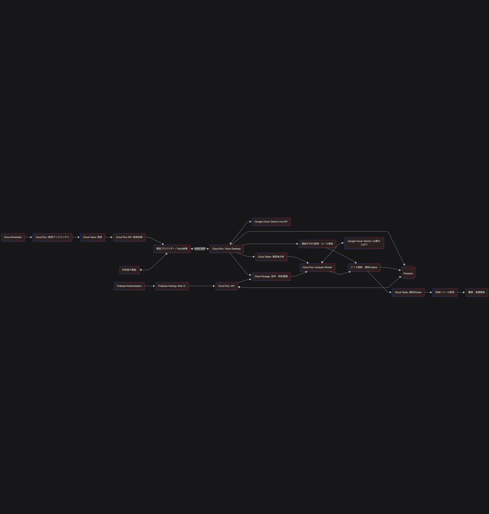

# Hachi — a daily AI check-in call for older English speakers living in Japan

Hachi phones each enrolled resident once a day for a short, friendly chat. It listens for signs that
something is wrong, both in **what** they say and in **how** they say it, and turns them into a
prioritised queue for care staff. When something looks urgent, staff (and, for emergencies, family)
are notified straight away.

**The resident needs a telephone and nothing else.** No app, no smartphone, no account, no Wi-Fi, no
permission prompt, no update. A landline is enough. They answer the phone and talk.

Built for the Google Cloud AI Builder Cup 2026 (Sustainability & Social Impact).

## The problem

Japan has a growing number of older people living alone, and among them are long-term residents who
came from abroad and are most comfortable in English. Local check-in services, helplines and
community visits are mostly in Japanese, families are often overseas, and care staff do not have the
time to call everyone every day. Problems such as a sudden illness, days of not eating, or a slow
change in speech that can come with cognitive decline are easy to miss until they become a crisis.

Hachi does not replace people. It makes a daily conversation possible at scale and tells staff
**who to look at first, and why**.

## Why a phone call

The people this is for are the ones a check-in app never reaches. Many are in their eighties, living
alone, and the device by their chair is a landline or a feature phone. Even where there is a
smartphone, installing an app, granting it a microphone, keeping it signed in and updating it are
four separate places to lose somebody — and the family who would normally help with that is in
another country, which is the reason the person is alone in the first place.

So the phone is not a fallback for users without the app. It is the whole channel, chosen because it
is the one that reaches this group, and everything else was built around that choice:

| | What the resident needs |
|---|---|
| **Hachi** | A telephone. Any telephone. |
| A typical app-based check-in service | A smartphone, the app installed, an account, notifications allowed, and the habit of opening it |

A phone call is also harder to build against than a web page, and that work is the substance of this
project rather than a detail of it:

- **Two-way audio bridging in real time** between Twilio Media Streams and the Gemini Live API,
  converting μ-law 8 kHz ↔ PCM 16 kHz in and PCM 24 kHz ↔ μ-law 8 kHz out, in 40 ms chunks, with
  barge-in handled so the resident can interrupt.
- **Stereo recording** (left = resident, right = Hachi) written to Cloud Storage, which is what makes
  response latency and self-repairs measurable afterwards; a mixed mono recording would not.
- **Emergency detection during the call**, not after it, so help is arranged while the person is
  still on the line.
- **A three-way bridge** that phones family and staff and joins whoever presses 1 into the resident's
  own call.
- **Silence as a signal** (R4): on a phone there is no "last seen" and no read receipt, so answering
  and not speaking is the only thing left to notice, and it is noticed.
- **Reconnection that the resident does not hear**, from a Gemini Live resumption handle, because a
  dropped websocket must not become a dropped conversation.

## How it works



1. **Dial.** Cloud Scheduler triggers the telephony service every minute; due residents are queued in
   Cloud Tasks (idempotent task names, so nobody is called twice) and dialled through Twilio.
2. **Talk.** Twilio streams the call audio to the Voice Gateway on Cloud Run (`us-central1`), which
   relays it to the Gemini Live API (`gemini-3.8-live`). Hachi introduces itself as an AI, says the call
   is recorded, asks about health and meals inside small talk, and picks up topics from earlier calls.
3. **Watch for emergencies during the call.** A rule-based monitor on the transcript and a Gemini tool
   call (`report_emergency`) both watch for acute danger. Either one opens an emergency case, sends
   alerts, asks the resident to call 119 if they can, and phones family and staff ("press 1 to be
   connected") to bridge them into the call.
4. **Record.** A stereo WAV (left = resident, right = Hachi) goes to Cloud Storage; transcript and call
   metadata go to Firestore.
5. **Analyse after the call.** The analyzer (Cloud Run + Gemini `gemini-3.8-flash`, structured output)
   reviews the call, measures speech features from the recording, compares them with the resident's
   own baseline, and merges the result into cases.
6. **Prioritise and notify.** Cases are ranked by urgency, then by confidence, overlapping signs,
   size and trend of change, vulnerability, and age. Each case carries a one-line reason. An outbox
   in Firestore feeds the notifier (SMS, email, web push, voice alert).
7. **Review.** Staff use the triage queue and case pages; family members see a read-only dashboard.
   Both are a React PWA on Firebase Hosting backed by the API on Cloud Run.

The web header, browser tab, installed app and push notifications use the original Hachi artwork
from [`japan-gse-builders/shutas-playground`](https://github.com/japan-gse-builders/shutas-playground).
See the [branding asset sources](apps/web/public/branding/README.md) for the exact files and hashes.

## The four rules

| Rule | What it looks for | Evidence | Urgency |
|---|---|---|---|
| **R1 Acute symptoms** | Chest pain, can't breathe, fallen and can't get up, and similar danger happening now. Hedged wording ("it's nothing, but my chest…") counts; past events, other people and denials do not. | What the resident says (in-call monitor + post-call review) | Immediate action |
| **R2 Not eating** | Little or no food, counted as consecutive days across calls (including "I haven't eaten for 3 days"). | What the resident says | 1 day: Monitor; 2+ days: Review today |
| **R3 Change in speech** | Slower responses, more self-repairs, narrower vocabulary, weaker topic coherence. | How the resident speaks, compared only with their **own** 28-day baseline (at least 8 usable calls) | Clear change: Review soon; slight change: Monitor |
| **R4 No response** | Picked up the phone and never spoke, through the greeting and two prompts. Also: answering, talking, then going quiet, if it happens again within the week. | The silence itself, plus the recording | Never spoke: Review today; repeatedly trails off: Monitor |

Response latency is measured from the stereo recording with voice-activity detection (transcript
timestamps lag by several seconds); self-repairs are counted by Gemini listening to the resident's
channel; lexical diversity is MATTR; topic coherence is scored by Gemini. Calls with too little speech
or temporary conditions (a cold, noise, poor audio) are excluded. Results are framed as "signs of
change", never as a diagnosis.

Urgency levels:

| Level | Meaning | Who is notified |
|---|---|---|
| Immediate action | Possible immediate danger to life or health | Staff and family, every channel, at once |
| Review today | Needs checking today | Staff |
| Review soon | Follow up within a few days | Nobody; staff see it in the queue |
| Monitor | No action yet; keep watching | Nobody; staff see it in the queue |

## Privacy and safety by design

- **Family see no recordings, transcripts or speech analysis.** The family dashboard shows the last
  14 days of calls (time, connected or not, duration), a short plain-language summary per call, the
  next call time, alerts sent to them and their status, and the staff contact. This is enforced in the
  API (`buildFamilyDashboard`), so residents can talk freely.
- **Recordings are staff-only.** Only the staff case page gets audio, through V4 signed URLs that
  expire after 15 minutes and only for the configured recordings bucket. The Voice Gateway can only
  create objects in that bucket.
- **No direct database access from browsers.** Firestore rules deny all client reads and writes; every
  request goes through the API, which checks Firebase ID tokens on each route. Staff are identified
  by a custom claim set with an admin script; family members sign in with an email link and only see
  residents whose registered family contact matches their verified email or phone.
- **Minimal data in messages and logs.** SMS carries no link, phone number or quote (Japanese carriers
  drop such messages from overseas senders) and fits one segment. Family messages never quote the
  transcript. Logs carry IDs rather than transcripts or addresses; idempotency keys store a hash of
  the address.
- **Synthetic data is labelled.** Evaluation and demo residents are generated with Cloud
  Text-to-Speech, named "(synthetic demo)", stored with `synthetic: true`, have no contact details and
  are never called.
- **Secrets live in Secret Manager**, mounted into Cloud Run at deploy time. Nothing secret is in the
  repository; `.env.example` lists non-secret settings only.
- **Safety rules in the voice prompt:** no diagnoses or medical advice, never "wait and see" in an
  emergency, no pretending to remember things that were not recorded.

See [docs/CONSENT_AND_PRIVACY.md](docs/CONSENT_AND_PRIVACY.md) for consent, retention and what is
enforced in code versus handled operationally.

The public `/privacy` page explains AI processing, recordings, sharing, retention and support without
requiring sign-in. Before a resident's first call, staff read a short explanation and answer questions;
the resident can simply say **“Yes, I agree.”** or give another clear affirmative reply. The full notice
is available on the page and in an expandable section of the form. Staff record the explicit
approval on **Add resident** or **Residents**. Details can be saved while approval is pending, but daily
calls cannot start. Existing residents need this record too; no approvals are inferred or backfilled.
Once recorded, approval is reused on later calls. **Pause calls** stops future check-ins; retention and
deletion requests are handled by the care organisation. The short first-use explanation includes
family updates about mood and loneliness, so there is no separate sharing checkbox. Previously
recorded sharing choices remain unchanged.

## Running cost, and the ceiling on it

Every resident costs money every day: a Live session billed by the second and a review billed by the
token. Nothing about that is self-limiting, so the service holds each call's worst-case cost against
a monthly budget **before the phone rings**, and refuses the call if the month cannot afford it. The
check and the reservation are one Firestore transaction, so calls placed at the same moment cannot
both take the last of it.

New check-in calls stop at 90% of the cap, and staff see why on their queue. **Reaching family and
staff about an emergency is never stopped** — a ceiling that silences that is not worth having.
Prices and the cap are environment variables, and a Google Cloud budget alert sits above the
application's own limit as a second line. See [docs/COST_CONTROL.md](docs/COST_CONTROL.md).

## Google Cloud services

| Service | Used for |
|---|---|
| Gemini Live API (Vertex AI) | Real-time voice conversation |
| Gemini (Vertex AI, `gemini-3.8-flash`) | Post-call review, summaries, listening for self-repairs, topic coherence |
| Cloud Run | telephony, voice-gateway, analyzer, notifier, API |
| Cloud Tasks / Cloud Scheduler | Dialling, emergency bridging, analysis and notification queues; periodic sweeps |
| Firestore | Residents, calls, cases, outbox |
| Cloud Storage | Call recordings |
| Firebase Authentication / Hosting / Cloud Messaging | Staff and family sign-in, web app, push alerts |
| Secret Manager | Twilio and SendGrid credentials |
| Cloud Build / Artifact Registry | Container builds |
| Cloud Text-to-Speech | Synthetic evaluation recordings only |

Outside Google Cloud: Twilio (phone calls and SMS) and, optionally, SendGrid (email).

## Evaluation

R3 was evaluated end to end on **synthetic** recordings: 10 synthetic people × 15 calls per seed, run
through the production measurement and analysis code. Across two seeds, all 10 people with a scripted
change were detected and none of the 10 stable people were flagged; response time was measured within
about 10 ms on average, and Gemini heard 95–97% of inserted hesitations. Thresholds were not tuned to
these runs.

Clean synthetic speech is much easier than real phone audio, so treat these numbers as an
**optimistic upper bound**, not as clinical accuracy. Details, per-person results and limitations:
[docs/eval/](docs/eval/) (start with [r3-synthetic.md](docs/eval/r3-synthetic.md)).

Automated tests cover the rules, prioritisation, notification policy and all services; see
[docs/TEST_RESULTS.md](docs/TEST_RESULTS.md) for test and field-trial results (in Japanese).

## Repository layout

```
packages/core      Domain logic: R1/R2/R3/R4, cases, prioritisation, notifications, schedule (pure functions)
packages/store     Firestore and in-memory data layer
packages/cloud     Cloud Tasks, OIDC verification, shared cloud helpers
services/telephony Dialling, Twilio webhooks, emergency bridging
services/voice-gateway  Twilio Media Streams <-> Gemini Live, in-call R1, recording
services/analyzer  Post-call analysis (and eval/ for the synthetic R3 evaluation)
services/notifier  SMS / email / push / voice alerts from the outbox
services/api       REST API for staff and family
apps/web           Staff triage UI and family dashboard (React + Vite PWA)
infra              Deploy scripts and admin helpers
```

## Local development

Requires Node.js 22.12 or later.

```bash
npm ci
npm run typecheck
npm test                 # Vitest: npx vitest run --configLoader runner
npm run test:coverage
npm run test:emulator    # Firestore contract tests (needs the Firebase CLI and Java)
npm run dev -w @hachi/web
```

The web app reads its Firebase web config and API URL from `apps/web/.env.local` (see the `VITE_*`
entries in `.env.example`; do not commit that file).

The synthetic R3 evaluation calls Gemini and Cloud Text-to-Speech in your own project:
`npm run eval:r3 -w @hachi/analyzer`. `npm run seed:demo -w @hachi/analyzer` loads synthetic demo
residents into Firestore.

## Deploy

Prerequisites: a Google Cloud project with billing, a Firestore database (Native mode), a private
Cloud Storage bucket for recordings, a Twilio account, and these Secret Manager secrets:
`twilio-account-sid`, `twilio-auth-token`, `twilio-api-key-sid`, `twilio-api-key-secret`
(and optionally `sendgrid-api-key`).

```bash
export PROJECT_ID=your-project-id
export RECORDINGS_BUCKET=your-recordings-bucket
export TWILIO_VOICE_FROM=+1XXXXXXXXXX   # your Twilio caller ID
export TWILIO_SMS_FROM=+1XXXXXXXXXX     # your Twilio SMS sender

./infra/deploy-telephony.sh
./infra/deploy-voice-gateway.sh
./infra/deploy-notifier.sh              # EMAIL_FROM=... if sendgrid-api-key exists
./infra/deploy-analyzer.sh
./infra/deploy-api.sh

npm run build -w @hachi/web
firebase deploy --project "$PROJECT_ID" --only hosting,firestore

node infra/set-staff-claim.mjs "$PROJECT_ID" staff@your-org.example
```

Services run in `asia-northeast1` except the Voice Gateway, which runs in `us-central1` next to the
Gemini Live API (so call audio is processed in the US). The scripts are safe to re-run.

## Limitations and roadmap

- **English only**, residents in Japan only (SMS is limited to +81 numbers).
- **R3 is validated only on synthetic audio.** Real calls, real baselines and real changes are needed
  before the thresholds can be trusted; staff feedback on each case is stored for that purpose.
- **Not a medical device.** It flags changes for people to check; it does not diagnose.
- **A phone that never rings through is not followed up yet**: there is no automatic retry for
  no-answer (technical failures are retried). Picking up and not speaking is now R4.
- **Consent is recorded by staff**, from the resident's explicit first-use approval. There is no
  automated spoken withdrawal or repeated approval prompt. **Retention and deletion remain
  operational** (see the privacy doc).
- **The monthly AI budget has never actually been reached** in production. The ceiling and the
  degradation are covered by tests, and the numbers it counts are our estimate, not Google's
  invoice ([docs/COST_CONTROL.md](docs/COST_CONTROL.md)).
- **Web push is implemented but not configured** in the current deployment; alerts go by SMS, email
  and voice.
- **The development environment uses a Twilio trial account with US numbers**, so calls today come
  from a US number and only reach verified numbers. Production needs a Japanese 050 number. This is
  an account to buy, not a design decision: the phone channel itself is the point of the service.
- Roadmap: more rules (medication, sleep, mood, falls, heat-stroke alerts), escalation and
  acknowledgement of notifications, WhatsApp calling, retention and deletion management in the app,
  Japanese conversations, and evaluation on consented real-world calls.

## License

[Apache License 2.0](LICENSE)

The web UI uses self-hosted **DM Serif Display** for headings, with the existing Avenir Next / Segoe UI
body stack. The font is licensed separately under the
[SIL Open Font License 1.1](apps/web/public/fonts/DMSerifDisplay-OFL.txt).
See [Web typography](docs/TYPOGRAPHY.md) for the heading scale, font-loading behavior, contrast
measurements and matched before/after screenshots.
