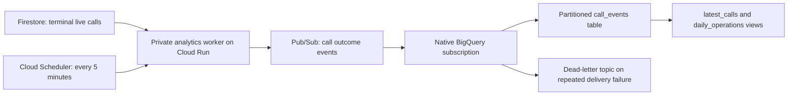

# Operational analytics with Pub/Sub and BigQuery

This optional pipeline answers: Are check-in calls getting through? Is analysis finishing? How
often does the in-call emergency/silence logic flag a call? It includes ordinary calls that never
produce a triage case. It does not affect triage, call scheduling, notifications, or the AI budget.



The separate worker keeps analytics failures out of the care path. Firestore remains the source
of truth. Pub/Sub buffers delivery to BigQuery without requiring a custom subscriber, and
BigQuery supplies operational reporting independently of the staff API. Cloud Tasks continues
to handle timed calls and urgent actions; this feature does not change those queues.

## Data and report definitions

- Only terminal **live** calls (`completed`, `no_answer`, `failed`) are exported. Imported history,
  scheduled calls and ongoing conversations are excluded. Paused patients' recent calls still count.
- An explicit organization allowlist is required. **Synthetic data only is the default.**
  `ANALYTICS_INCLUDE_REAL_DATA=true` additionally permits real calls from those organizations.
- Events contain status, timestamps, duration, channel, daily/staff trigger, retry attempt number,
  analysis state and two in-call flag booleans. They never include names, contact details, resident
  IDs, transcripts, summaries, quotes, audio, staff IDs, provider errors or stream tokens.
- Organization and call identifiers are SHA-256 hashes with separate namespaces; a call key
  includes organization, resident and call ID. These are **pseudonymous, not anonymous**: an
  operator with source IDs can calculate them. Treat timing and flag data as restricted too.
- `latest_calls` selects one latest source revision per call, regardless of duplicate delivery
  or arrival order. The revision includes Firestore nanoseconds, not just millisecond timestamps.
- `daily_operations` groups by Japan calendar date, organization key and synthetic flag. Never
  combine synthetic and real groups when evaluating live operations.
- Counts are **call attempts, not unique patients**. A technical retry is another attempt.
  Completion means the source call status is `completed`; it is not proof that the resident spoke
  or was well. Duration is averaged only for completed calls with a recorded duration.
- `analysis_state` is `pending`, `complete`, `partial`, `missing` or `not_applicable` (unanswered/
  failed). Partial includes model or voice errors. This is the latest state, not a count of every
  analysis retry or a measurement of model accuracy.
- `emergency_flagged` / `calls_with_emergency_flags` cover the call's **in-call emergency record
  or silence escalation flag**. They do not count every post-call R1 case, prove an emergency,
  or confirm an alert was delivered. `calls_with_silence_escalations` is the silence subset.

The reports are for project operators with BigQuery access. They are not exposed through the
staff/family API. Organization keys support grouping, **not tenant authorization**. Do not grant
care organizations access to the shared dataset; a future tenant dashboard needs authorized views
or server-enforced organization filtering first.

## Test locally without Google Cloud

From the repository root, with Node.js 22.12+ and dependencies installed:

```bash
npm run demo:analytics
npm test -- services/analytics/test
```

The demo uses the real event mapper and export worker with an in-memory source and publisher.
It makes no network requests. Expect **6 attempts: 4 completed, 1 unanswered, 1 failed**, with
1 partial analysis and 1 in-call emergency flag. A repeated scan publishes nothing. One pending
analysis is updated to complete; two delayed copies of the older event still leave six calls and
zero pending analyses. The local aggregation simulates the views; it does not execute BigQuery.

Tests cover payload minimization, schema compatibility, source projections, authentication,
organization/synthetic filtering, bounded pagination, retries, lost acknowledgements and old
source revisions. Live Google Cloud IAM, index readiness and native delivery require the smoke
test below; passing local tests is not evidence that the cloud resources have been deployed.

## Deploy in the existing Hachi project

An operator with access to the teammate's project must run this. Prerequisites: billing enabled;
the existing Hachi Firestore database, `hachi` Artifact Registry repository and `hachi-build`
service account; Node/npm; current Google Cloud CLI (`gcloud`, `bq`); and permission to deploy
Cloud Run, indexes, Pub/Sub, BigQuery, service accounts/IAM and Cloud Scheduler. The script invokes
Firebase CLI through `npx`; authenticate it for the project too (`npx firebase-tools@15 login`).

```bash
gcloud auth login
PROJECT_ID=hachicall-nao \
  ANALYTICS_ORG_IDS=YOUR_ORGANIZATION_ID \
  ./infra/deploy-analytics.sh
```

Use the Firestore organization document ID, not its display name. Multiple IDs are comma-separated.
The script defaults to Tokyo, dataset `hachi_analytics`, topic `hachi-call-outcomes-v1`, and
synthetic-only export. It deploys the repository's Firestore indexes (including the collection-group
`calls.startedAt` index), a private `hachi-analytics` worker and a five-minute scheduler job. It
does not redeploy the web app or the calling, analysis or notification services.

Wait for the new Firestore index to finish building. The worker returns a sanitized 503 while
the source query is unavailable; a later scheduled scan retries. The script can be rerun. Existing
tables use `CREATE TABLE IF NOT EXISTS`; a future event-schema change needs a deliberate migration
or a new versioned table/topic, not just rerunning this script.

The runtime service account gets `roles/datastore.user` (project-wide Firestore access) and
publisher access on this topic. Code writes only `analyticsState`, never care records. It receives
no BigQuery, recordings, call-provider or notification credentials. A separate scheduler account
gets Cloud Run invoker access, and the application also verifies its Google OIDC token. Pub/Sub's
service agent gets BigQuery Data Editor on the **raw table**, plus the topic/subscription permissions
needed for dead-letter delivery. Existing project administrators retain their project access.

To permit real data, the project owner should first confirm the organizations and their approved
processing/retention policy, then rerun the same command with `ANALYTICS_INCLUDE_REAL_DATA=true`.
This switch does not record resident approval. The current resident onboarding and care behavior
are unchanged; no real data is exported by this feature's default deployment.

Code-only redeployment after initial setup:

```bash
PROJECT_ID=hachicall-nao ./infra/deploy-code.sh analytics
```

The existing Deploy web GitHub workflow does **not** deploy this worker or its Pub/Sub/BigQuery
resources. Deploying the analytics script is an additional step. BigQuery, Pub/Sub, Firestore reads,
Cloud Run and Scheduler charges are outside Hachi's AI spending ledger; use project budget alerts.

## Verify actual Pub/Sub → BigQuery delivery

With operator Application Default Credentials authorized to publish to the topic:

```bash
gcloud auth application-default login
npm run demo:analytics -- --publish --project hachicall-nao --topic hachi-call-outcomes-v1
```

This explicitly sends **nine synthetic events** to the existing topic; it creates no patients,
phone calls, care cases, or notifications. They use the separate `hachi-analytics-demo` organization
key printed by the command. The source scan's organization list does not affect this direct
synthetic publishing test. Publishing success confirms Pub/Sub acceptance; verify delivery separately:

```sql
SELECT * FROM `hachicall-nao.hachi_analytics.daily_operations`
WHERE synthetic = TRUE
  AND organization_key = TO_HEX(SHA256('["hachi-organization-v1","hachi-analytics-demo"]'))
ORDER BY call_date DESC;
```

After native delivery completes, expect the demo date to show `call_attempts=6`, `completed_calls=4`,
`unanswered_calls=1`, `failed_calls=1`, `completion_rate≈0.667`, `analysis_pending=0`,
`analysis_partial=1`, `calls_with_emergency_flags=1`, `calls_with_silence_escalations=1`.
Repeating the demo on the same UTC date still produces six logical calls. The raw table can have
more rows because updates and at-least-once delivery are intentional. Use the views for reports.

To verify the **Firestore worker** too, use an allowed organization with an existing terminal live
call marked synthetic (on the call or resident), run the scheduler job, then check worker counts
and the view. Imported demo/evaluation recordings are excluded by design:

```bash
gcloud scheduler jobs run hachi-analytics-export --project=hachicall-nao --location=asia-northeast1
gcloud run services logs read hachi-analytics --project=hachicall-nao --region=asia-northeast1 --limit=20
gcloud pubsub subscriptions describe hachi-call-outcomes-v1-bigquery --project=hachicall-nao
```

An authorized real-data deployment can use a normal existing live call instead. Do not relabel
real calls as synthetic. Logs contain aggregate scan counts only. Check the subscription's
`bigqueryConfig.state`, backlog and oldest unacknowledged message age if no rows arrive. A missing
table, schema mismatch or permissions error requires correction even if publication succeeded.
Repeated failures go to `hachi-call-outcomes-v1-dead-letter`, retained by its `-inspect` subscription
for seven days. Inspect there after fixing the root cause; replay the original JSON payload to the
main topic (dead-letter messages wrap the original message). Deduplication makes replay safe.

## Retry, retention and deletion

- Firestore is the durable source. A send is checkpointed only after Pub/Sub acknowledges it.
  Lost acknowledgements/receipt writes can cause duplicates; they do not inflate the views.
- Malformed source records increment the logged `invalid` count and are skipped for that cycle,
  without blocking later calls. They are revisited on the next full scan, so corrected records
  export normally. Invalid rows are not sent to Pub/Sub; delivery failures use its dead-letter path.
- Each invocation scans up to 500 documents by default, in pages of 100. A persisted timestamp +
  document-path cursor continues next time, then resets to revisit recent changes. The default
  lookback is 30 days; large backlogs can take several scheduled runs. A four-minute work budget
  and ten-second publish timeout leave room inside the five-minute request deadline.
- Runtime overrides: `ANALYTICS_LOOKBACK_DAYS` (1–90), `ANALYTICS_PAGE_SIZE` (1–500),
  `ANALYTICS_MAX_PAGES` (1–100). Set them with a Cloud Run environment update; the full deployment
  script resets them to defaults, while `deploy-code.sh analytics` preserves them.
- Changes to calls older than the lookback are not captured automatically. Pause the scheduler,
  widen the lookback up to 90 days, clear **only** the analytics stream's cursor, and resume for a
  controlled backfill. Existing receipts still avoid unchanged publishes. To rebuild a lost sink,
  use a new versioned topic/table or deliberately clear its analytics receipts after inspection.
- Pub/Sub subscriptions retain unacknowledged messages for seven days. BigQuery raw partitions
  expire 90 days after their call-date partition; views retain no extra copies. The deploy script
  restricts Pub/Sub message storage and the dataset to the configured region, default Tokyo.
- Deleting a Firestore call does **not** automatically delete its exported rows. For an individual
  deletion, pause the scheduler and stop any active export; compute call keys from that resident's
  source IDs before removing them. Remove/exclude the source, handle pending main/dead-letter
  messages that could restore it, then delete the relevant raw rows with a `call_started_at`
  partition filter and `call_key IN (...)`. Remove the matching analytics receipts too. Resume only
  after confirming the records cannot be republished. BigQuery's own recovery retention applies.
- Receipts hold hashes, revisions and a source document-path cursor in private Firestore
  `analyticsState/{topic}`. They do not have a TTL. Include them in the operator's deletion policy.

Reference documentation: [native BigQuery subscriptions](https://docs.cloud.google.com/pubsub/docs/create-bigquery-subscription),
[message storage policies](https://docs.cloud.google.com/pubsub/docs/resource-location-restriction),
[BigQuery table IAM commands](https://docs.cloud.google.com/bigquery/docs/reference/bq-cli-reference#bq_add-iam-policy-binding).
