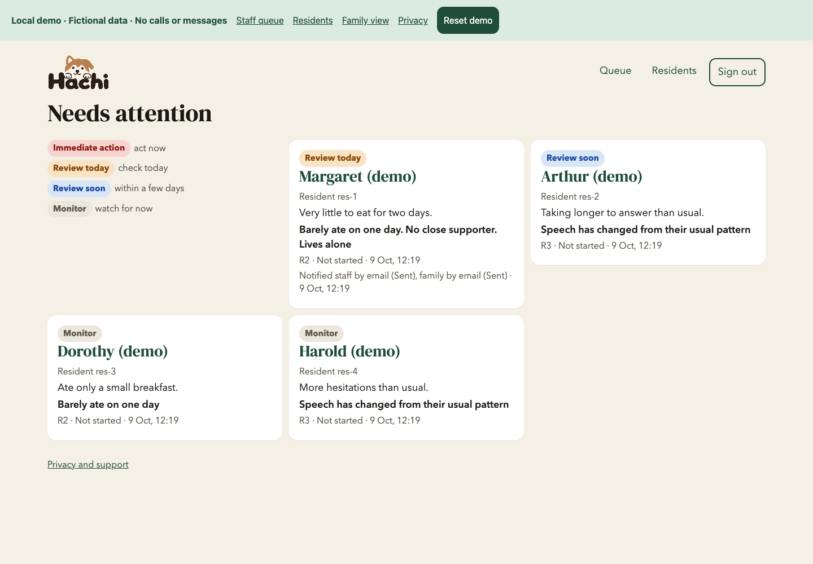
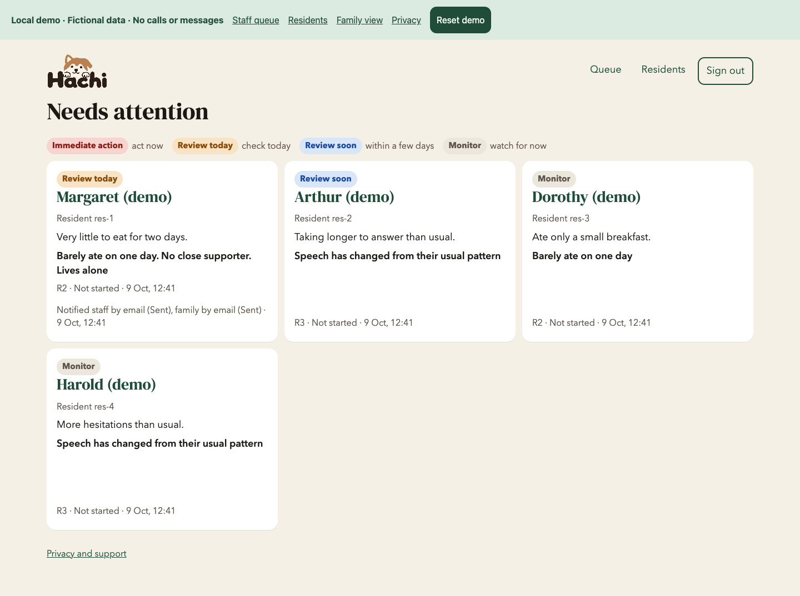

# Panel layout review

Card collections use one shared grid. Headings, legends, errors and service notices sit outside
that grid, so they never take the place of a card. At desktop widths, cards in a collection have
equal widths and heights across rows, sized to the longest content. Names and notes can wrap;
content is not cut off. On phones the cards form one readable column.

The case page has two equal desktop panels: evidence, screening and the update form on the left;
notifications, calls and history on the right. The sections inside each panel keep their headings
and dividers. Single forms and family pages use the same 760px maximum reading width. Family
life-area tiles have equal heights too.

An expanded first-use approval spans the full list width on desktop and lets that row grow.
Closing it restores the regular card grid. Wide screening and call-history tables scroll within
their own labelled, keyboard-focusable regions, including on 320px phones.

## Pages checked

The review covered every page component and shared panel component in `apps/web/src`, the only
application UI in this repository. Browser checks used fictional residents in the combined local
preview, including the pending changes in PRs #22–24. This PR contains the layout changes only.

| Page | Review |
| --- | --- |
| Queue | Equal card sizes across rows; urgency legend above all cards, contact requests and service notices; long names, longer summaries and empty queue |
| Residents | Equal list cards; aligned import controls; pending/approved residents; long names; expanded approval and full notice |
| Case | Equal desktop panel sizes; evidence, screening, update form, notifications, calls, history and speech charts; contained tables |
| Add resident | Consistent form width; fields, circumstances, contacts and approval remain readable |
| Family home | Equal resident cards; verified, unverified and unlinked accounts |
| Family dashboard | Legend above dashboard panels; equal life-area tiles; table scrolling; alerts, care contacts, call notes and phone-alert panel |
| Staff sign-in | Consistent form width; fields and alternate sign-in controls fit |
| Family sign-in | Same form dimensions and spacing as staff sign-in |
| Finish sign-in | Consistent width for the confirmation form and invalid-link message |
| Privacy | Consistent reading width; full notice and support fit on small screens |

Checks passed at 1440, 1024, 900, 768, 390 and 320px: **85 page/width/state combinations**.
They compared actual panel dimensions, confirmed legends were above the panels, and checked for
page overflow and clipped content. Separate interaction checks confirmed recording approval,
pause/resume, the logo and the heading font still work. No real calls or messages were sent.

## Screenshots

These images use only fictional demo data. The logo and heading font come from the other open PRs
included in the review preview.

| Before | After |
| --- | --- |
|  |  |

[Residents after](screenshots/panels/residents-after-1440.png) ·
[Family dashboard on a phone](screenshots/panels/family-after-390.png)
